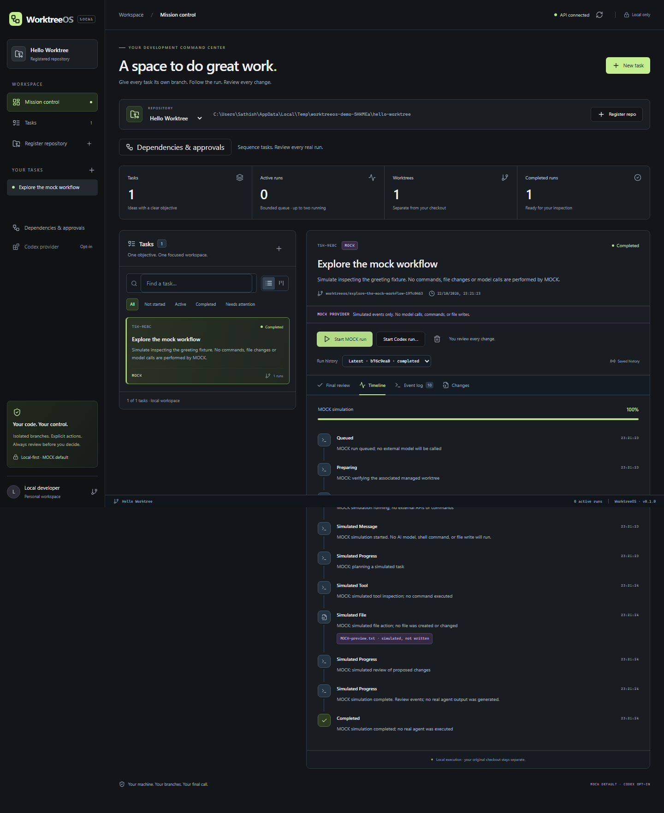
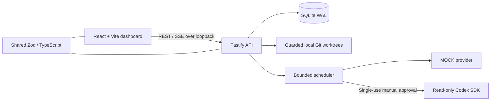

# WorktreeOS

Local mission control for coding tasks: give each task a Git worktree, follow live execution, and review changes before deciding what to merge. **MOCK** works without keys. Real Codex requires a separate, single-use approval and currently uses a read-only sandbox.



Captured from the running Windows demo, 2026-10-22. The timeline is a labeled simulation; MOCK does not generate code. [Mobile capture and reproduction guide](docs/DEMO.md).

## Windows PowerShell quickstart

Install **Node.js 24 LTS**, npm, and Git on PATH. Minimum supported Node is 22.13; CI targets Node 24. Clone the repository, then install and start the isolated demo:

```powershell
node --version
git --version
git clone https://github.com/nivedhbot/WorktreeOS.git
Set-Location WorktreeOS
npm.cmd ci
npm.cmd run demo
```

Open the **127.0.0.1 URL printed in the terminal**. Select **Hello Worktree**, click **Create worktree**, then **Start MOCK run**. Expect **API connected**, a live timeline, and **Completed**. No account, API key, login, or `.env` is needed. A clean diff is expected: MOCK simulates actions without writing files.

`demo` builds the app and starts a real API and production UI on unused loopback ports. It explicitly creates one tiny deterministic Git repository and one mock task in a new OS temp directory, with SQLite/worktrees alongside it. It ignores your `.env` and app-data overrides and disables Codex discovery/execution. **Enter** stops both servers cleanly (Ctrl+C interrupts); the printed directory and records remain for inspection. Each invocation creates a new demo. See [demo lifecycle](docs/DEMO.md).

```powershell
# Automated acceptance: build, complete MOCK over HTTP, restart API, check history.
npm.cmd run demo:smoke
```

Linux/macOS use the same commands with `npm` instead of `npm.cmd`. The demo needs no fixture dependencies or model credentials; dependency installation itself requires registry access.

## Develop with local repositories

```powershell
# Optional; defaults work without this file.
Copy-Item .env.example .env
npm.cmd run dev
```

Open **http://127.0.0.1:5173**. The API binds to **127.0.0.1:3001**; Vite proxies `/api`. `dev` builds shared contracts and watches all three workspaces. Register an existing local Git root, create a task, explicitly create its worktree, then start MOCK. No records are seeded at startup. Ctrl+C stops the runner. Use `npm.cmd` when PowerShell blocks `npm.ps1`; no execution-policy change is required.

| Setting                     | Default / purpose                                              |
| --------------------------- | -------------------------------------------------------------- |
| `WORKTREEOS_DATA_DIR`       | Absolute path; defaults to `~/.worktreeos`, outside source     |
| `WORKTREEOS_WORKTREE_DIR`   | Absolute path; defaults to the data directory's `worktrees/`   |
| `API_PORT`                  | `3001`; Vite's default proxy follows it                        |
| `API_TARGET`                | Optional Vite proxy override matching the API loopback address |
| `WORKTREEOS_CONCURRENCY`    | `2` total; tasks in the same repository serialize              |
| `WORKTREEOS_QUEUE_CAPACITY` | `32`; bounded waiting budget                                   |
| `WORKTREEOS_RUN_TIMEOUT_MS` | `900000`; preparation plus execution timeout                   |

Keep data/worktrees outside the checkout and registered repos. Shell variables take precedence over `.env`. Never put secrets in browser-exposed `VITE_*` variables. See [.env.example](.env.example) and [runbook](docs/RUNBOOK.md).

To explicitly add a sample task to an existing validated repository, without starting anything:

```powershell
npm.cmd run seed:dev -- --repo "C:/Projects/my-local-repo"
```

## Features

- Repository/task registration, list/detail/edit, shared Zod validation and durable SQLite migrations.
- Managed Git worktree creation, status, tracked patches and changed-file inspection; explicit clean-tree removal retains its branch.
- MOCK execution, append-only history, live SSE/reconnection, cancel, explicit retry and restart recovery.
- Bounded scheduling, per-repository execution/mutation guards and interrupted-run reconciliation.
- Dependency DAG with cycle prevention, readable readiness list and keyboard forms alongside the visual graph.
- Queued real-run requests, exact context review, expiring single-use approval, provider-specific prerequisites and final review.
- Dark dashboard with board/list/search/filter, loading/error feedback and keyboard dialogs. At **760px and below**, mutation controls are read-only.

## Architecture



| Workspace         | Responsibility                                                                                                      |
| ----------------- | ------------------------------------------------------------------------------------------------------------------- |
| `apps/web`        | React, strict TypeScript, Vite, Tailwind v4, editable shadcn/ui components with Radix, lazy React Flow              |
| `apps/api`        | Fastify, Node SQLite, seven transactional migrations, typed storage, guarded Git, scheduler, REST/SSE and providers |
| `packages/shared` | Zod contracts and inferred types, compiled ESM/declarations                                                         |
| `scripts` / `e2e` | Demo, platform verification and isolated Chromium integration fixtures                                              |

No hosted database, remote Git service, container runtime or model account is required for MOCK. SQLite lives outside source; events and status changes commit together. A PID lock prevents two API schedulers using one data directory. [Architecture and lifecycle details](docs/ARCHITECTURE.md).

## Optional Codex: manual consent

Use `npm run dev`, not the isolated demo. WorktreeOS reuses existing Codex CLI authentication configured separately on your machine. It has no login/key form, does not read credential files or store account credentials. Opening **Start Codex run…** performs bounded, read-only account/model discovery; it does not start a model turn.

1. Select a task and managed worktree. Choose an account-visible supported model (`gpt-6-luna` defaults; `gpt-6.1-sol` appears only when available).
2. **Add to approval queue** saves a request without execution.
3. In **Dependencies & approvals**, choose **Review and approve**. Review the exact objective/revision, repository, worktree path, fixed model and context/usage risk.
4. Check the fresh acknowledgement and click **Approve and start Codex** for one run. Changed, expired, rejected or consumed approvals fail closed. There is no silent model fallback or automatic real retry.

Real runs can send task/repository context to the configured model service and incur account usage. They use **read-only**, **automatic denial of approval requests**, disabled tool network/search and no MCP servers. Model transport still requires network. Commands needing SDK approval that the app cannot supply fail closed. This release has no real file-writing agent mode. [Authentication/provider details](docs/CODEX.md) · [Approval semantics](docs/WORKFLOW.md).

## Safety boundaries

Registration accepts an existing canonical local Git root only. URLs, UNC/device paths, traversal, symlink aliases, bare/nested roots and external Git metadata are rejected. Git uses fixed executable/argument arrays, with hooks, external diff helpers and filters disabled. The application never clones, fetches or accesses remote repositories.

MOCK never invokes a model, shell tool or file write; explicit worktree creation still performs local Git operations. There is no auto merge, push, reset or force removal. Removal requires confirmation and refuses dirty/untracked/ignored/hidden-index changes and active/queued writers. Review and run repository tests yourself before a manual merge; a completed simulation is not code/test evidence.

The API is loopback-only with Host/Origin/cross-site guards, not a multi-user authenticated service. Do not expose it through a tunnel or reverse proxy. Known-pattern credential redaction protects new logs/events on a best-effort basis, not general secret detection; it does not rewrite old histories. [Security coverage and limits](docs/QA.md).

## Verification and CI

```powershell
npm.cmd exec -- playwright install chromium
npm.cmd run verify
npm.cmd run demo:smoke
```

`verify` runs lint, strict typechecking, Vitest, production build, Chromium E2E and formatting. Individual commands: `npm run lint`, `npm run typecheck`, `npm test`, `npm run build`, `npm run test:e2e`, `npm run format:check`. Platform wrappers: `./scripts/verify.ps1` and `bash scripts/verify.sh`. Linux browser dependencies: `npm exec -- playwright install --with-deps chromium`.

[GitHub Actions](.github/workflows/ci.yml) defines quality checks plus Windows/Ubuntu test/build/demo/browser jobs on Node 24, without model credentials, following [setup-node](https://github.com/actions/setup-node) and [Playwright CI](https://playwright.dev/docs/ci) guidance. Windows and Ubuntu jobs passed in [hosted run 39896934560](https://github.com/nivedhbot/WorktreeOS/actions/runs/39896934560). Current evidence is recorded in [SESSION_STATE](docs/SESSION_STATE.md). Chromium results do not imply other-browser or authenticated model verification.

## Demo, operations and release

- [Screenshots and 45-second GIF/demo guide](docs/DEMO.md)
- [Operations, backups and troubleshooting](docs/RUNBOOK.md)
- [Release checklist and license suggestion](docs/RELEASE.md)
- [API](docs/API.md) · [Worktrees](docs/WORKTREES.md) · [Runs](docs/RUNS.md) · [Scheduler](docs/SCHEDULER.md) · [Dashboard](docs/DASHBOARD.md)

A project license has not been selected; review the release checklist before public distribution. No tagged release, installer, GIF or authenticated model result is claimed.
