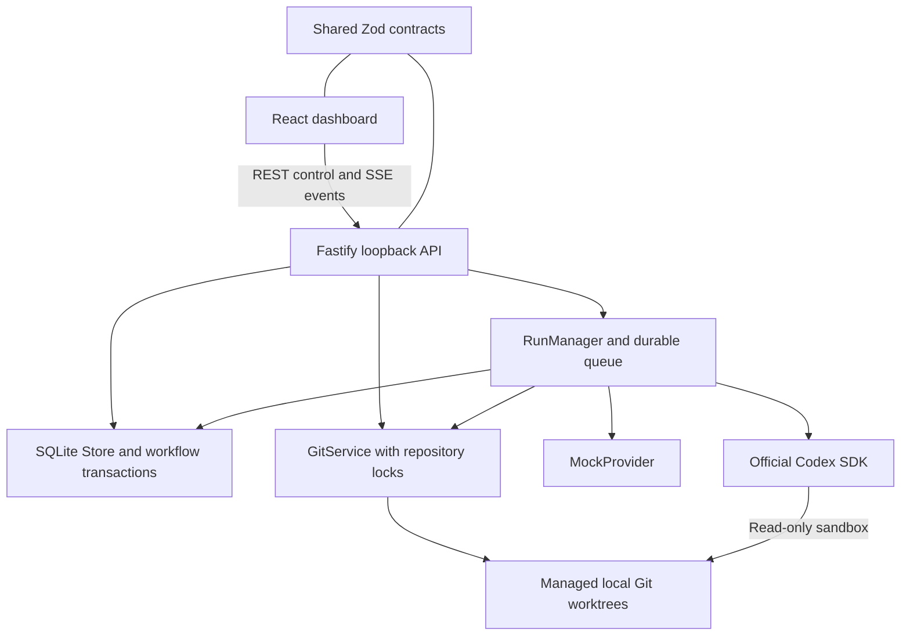
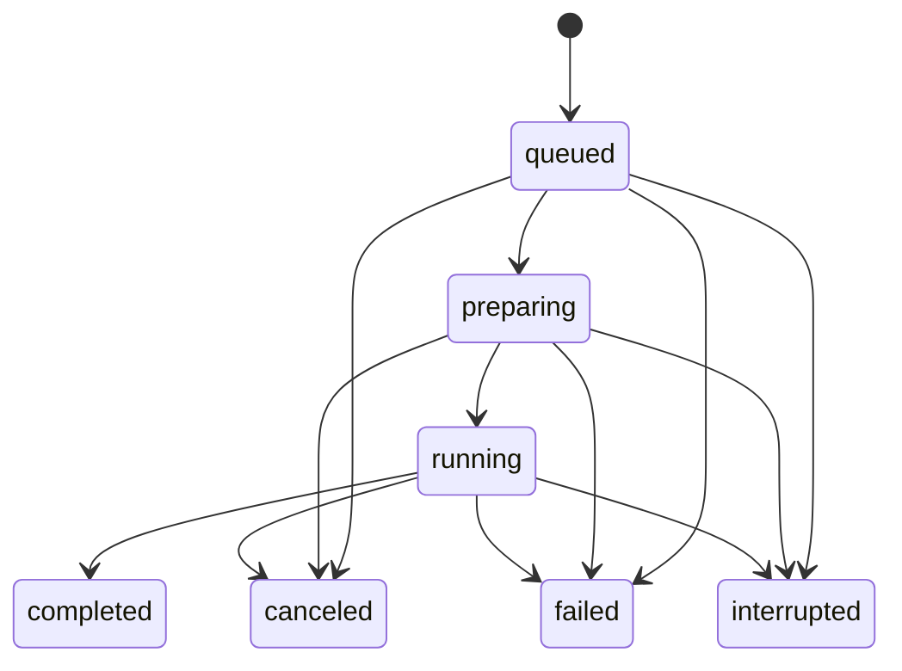

# WorktreeOS architecture

WorktreeOS is a single-user local application. The browser controls a loopback API; the API owns persistence, Git operations and execution. MOCK is usable offline after dependency installation. Real Codex is opt-in and read-only.

The repository root contains `apps/`, `packages/`, `docs/`, `scripts/`, `e2e/`, `.agents/` and root npm/Git/CI configuration. Run `npm ci` and all workspace commands from this root. CI uses the same layout; no nested starter directory is part of the application.

## Components and ownership

| Area            | Entry points                                         | Responsibility                                                                                     |
| --------------- | ---------------------------------------------------- | -------------------------------------------------------------------------------------------------- |
| Contracts       | `packages/shared/src/`                               | Strict input validation, domain types, legal run transitions and provider events                   |
| API composition | `apps/api/src/app.ts`, `server.ts`                   | Local security, ownership before migrations, route registration, safe errors and shutdown          |
| Persistence     | `apps/api/src/storage/`                              | Seven transactional migrations, repositories/tasks/worktrees/runs/events, DAG and approvals        |
| Git             | `apps/api/src/git/`, `repositories/validate-path.ts` | Canonical paths, fixed argument arrays, isolated worktrees, bounded inspection and guarded removal |
| Execution       | `apps/api/src/runs/`, `agents/`                      | Queue admission, scheduling, cancellation/recovery, provider adaptation and Codex policy           |
| Dashboard       | `apps/web/src/App.tsx`, `hooks/`, `components/`      | Repository/task editing, run monitoring, diffs, lazy dependency graph and approval review          |
| Acceptance      | `e2e/`, `scripts/demo.ts`                            | Isolated real HTTP/Git/SQLite workflows without model calls                                        |

## Storage contracts

SQLite uses WAL and foreign keys. Data defaults to `~/.worktreeos/worktreeos.sqlite`; source files live in Git repositories/worktrees, not the database. A stopped backup must include the data directory and the corresponding Git repositories and worktree path relationships. See [operations](RUNBOOK.md).

Repository records identify canonical local roots. Tasks retain editable titles/objectives and revision numbers. Each run saves its task snapshot, provider, worktree, status and available real thread/usage metadata. `execution_provider` is authoritative; the legacy `runs.provider` column keeps its original MOCK-only constraint for migration compatibility. Run history is ordered by creation time and SQLite insertion order.

Status transitions and their events commit together. Per-run event sequences increase monotonically; SQL triggers prohibit event UPDATE/DELETE. Partial unique indexes prevent overlapping queued/active runs for the same task or worktree. Dependency edits commit transactionally and reject missing references, self-edges and cycles. Approval fingerprints bind the reviewed revision, model, worktree and prerequisite state.

Worktree reads by ID use the primary key; reads by task use the partial active-task index. Listing remains ordered for the dashboard. This keeps execution validation and task worktree lookups proportional to the requested row rather than scanning all worktrees.

## Execution lifecycle

1. The user registers a repository and creates a task and its managed worktree explicitly.
2. A MOCK start validates context and admits a durable queued run. Real runs first require a pending approval request, exact-context review, fresh acknowledgement and atomic single-use confirmation.
3. The scheduler selects the oldest eligible work. Default concurrency is two across repositories and one per repository. Queue capacity is 32; active plus waiting admission is bounded to 34.
4. Dispatch validates paths, branch, dependencies and consent again, acquires the execution lease, then moves through `preparing` and `running`.
5. The provider yields structured events. Completion, failure, cancellation or interruption becomes terminal. Explicit retry creates a separate MOCK record; real retry requires new approval.

Approval requests are separate from executing runs. `awaiting_approval` remains in the shared compatibility enum but is not an execution state emitted by this workflow. Completed, failed, canceled and interrupted records never return to active.

Cancellation and the preparation/execution timeout signal the provider and retain the lease through iterator cleanup. Tests cover delayed cleanup with injected providers; authenticated native Codex cancellation remains unverified. Graceful shutdown stops dispatch and waits for cleanup. On restart, active runs and queued real runs become interrupted; only eligible queued MOCK work resumes. No automatic real replay or execution retry occurs.

`scheduler.lock` provides data-directory PID ownership. An atomic `scheduler.recovery` directory serializes stale-lock reclamation. Invalid/live/inaccessible ownership fails closed. A crash during reclamation can leave a recovery directory requiring manual inspection; see [scheduler](SCHEDULER.md).

## Streaming and browser consistency

REST returns saved history; SSE replays and then subscribes without an asynchronous gap. Cursors must belong to the requested run. SQLite selects only later event sequences. `Last-Event-ID` overrides the original query cursor on native EventSource reconnect. Streams have heartbeat, connection and output-buffer bounds and close on terminal status or shutdown.

The browser validates event/status payloads, ignores duplicate or older sequences and reconnects from the last verified cursor. Terminal status cannot be overwritten by a delayed start response. Repository rename and task edits preserve selected history; changed task context invalidates approval. Mobile widths at or below 760px support inspection with mutation controls disabled. React Flow is loaded separately; keyboard forms and readiness text provide graph alternatives.

## Trust boundaries

- The API validates raw loopback socket, Host, Origin and cross-site request context. This is not remote or multi-user authentication.
- Git accepts canonical existing local roots and fixed argument arrays. It rejects path/branch injection, external metadata and symlink escapes; worktrees do not themselves provide an agent sandbox.
- Removal is explicit, refuses dirty/ignored/hidden-index changes and queued/active writers, and retains branches. The application never merges, resets, pushes or force-removes.
- MOCK events are labeled simulation and never call a model or write source. Codex uses the official SDK with a read-only sandbox, denied escalation, disabled tool network/search and explicitly disabled configured MCP servers, plugins, hooks, apps and sub-agents.
- A child-process marker blocks nested WorktreeOS startup/discovery/execution. It prevents accidental recursion; it is not a defense against a hostile local user who can change environment or configuration.
- Request audits omit bodies, headers and query contents. Known credential patterns are redacted from new event payloads, not arbitrary secrets or old append-only history. Local databases and worktrees remain private user data.

See [Codex](CODEX.md), [workflow](WORKFLOW.md), [QA](QA.md) and [production readiness](RELEASE.md) for detailed guarantees and limits.

## Verification model

Unit and integration tests exercise real SQLite and temporary Git repositories. Scheduler tests cover concurrent repositories, approval staleness, timeouts, cancellation, process recovery and competing lock reclaimers. Native Codex tests inspect configuration with an empty temporary home; SDK/model execution uses fakes. Chromium E2E uses real production UI and API instances with isolated data and fake Codex only. GitHub Actions repeats installation, tests, build, MOCK restart smoke and Chromium on Windows and Ubuntu. No model credentials or paid turns are used.
