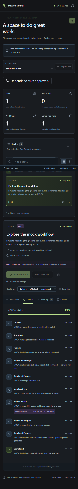

# Reproducible MOCK demo

## First run

From a fresh checkout with Node 24 and Git on PATH:

```powershell
npm.cmd ci
npm.cmd run demo
```

The command builds all workspaces, allocates a **new** `worktreeos-demo-*` directory under the canonical OS temp directory, initializes `hello-worktree` and commits three tiny files. Author, dates, branch, contents and commit message are fixed. Two fixture creations have identical initial commit IDs; UUIDs, timestamps, temp paths and ports are intentionally unique. There are no remotes or fixture dependencies. The retained root is printed before server startup, including on later setup failures.

It explicitly registers **Hello Worktree** and **Explore the mock workflow** over the real API. Normal app startup still seeds nothing. The demo ignores `.env`, uses its own SQLite/worktree paths and unused 127.0.0.1 ports, and disables Codex availability even on signed-in hosts. It does not discover authentication or execute an SDK task.

Open the printed UI URL. Confirm **API connected**, click **Create worktree**, then **Start MOCK run**. Follow Timeline and Event log through **Completed**. Changes and Final review show actual Git state. A clean diff and no token total are correct: MOCK writes no files and has no model usage. You can inspect the fixture separately:

```powershell
# Replace this with the exact printed demo root.
Push-Location "C:/Users/you/AppData/Local/Temp/worktreeos-demo-EXAMPLE/hello-worktree"
node --test
Pop-Location
```

This greeting test is a separate manual command, not something MOCK executed. To demonstrate a patch, manually edit `greeting.mjs` in the **managed worktree path shown in the app**, then open Changes. Identify it as a manual edit. The original fixture checkout should remain clean. Use disposable fixtures for presentations.

## Lifecycle and restart

Press Enter to close preview connections, settle providers, close SQLite and release the scheduler lock cleanly. Ctrl+C interrupts; an abrupt terminal/process interruption may leave a stale lock, which normal startup validates and reclaims. The directory is retained, including `demo.json` with non-secret paths, IDs and session URLs. URLs stop working after shutdown. Each `npm run demo` creates a new session; it never resets or overwrites old records.

`npm run demo:smoke` completes a MOCK task over HTTP, closes/reopens the real API against the same data, compares run/event history and exits. It retains the printed root for inspection. To inspect an old interactive session using development services, stop its servers, set `WORKTREEOS_DATA_DIR` and `WORKTREEOS_WORKTREE_DIR` to its exact absolute `data` and `worktrees` paths, then `npm run dev`. This is normal development mode, where manually approved Codex is available; keep the presentation MOCK-only. Remove those shell overrides afterwards.

There is no recursive-delete command. After stopping servers, inspect the exact printed root in File Explorer and delete only that demo folder when finished. Do not remove `~/.worktreeos` or registered repositories. Interrupted setup may leave a partial root; the next run creates a new directory.

## Actual screenshots

These checked-in PNGs were captured from the running demo on Windows on 2026-10-22 and visually inspected:

- [Desktop, 1440px viewport](images/mock-dashboard.png): live API, an actual managed Git worktree and completed MOCK timeline.
- [Mobile, 390px viewport](images/mock-mobile.png): the same persisted run, read-only controls and stacked panels.



No code changes, usage totals or real-agent output were invented. Captures include a disposable local Windows path and actual timestamps. To replace them, start a fresh demo, complete the steps above, and capture the browser at the stated widths. Review private paths/content before publishing; keep provider labels and simulation disclosures visible. Save actual PNGs to `docs/images/`.

For full-app QA captures:

```powershell
npm.cmd exec -- playwright install chromium
npm.cmd run test:e2e
```

The workflow, graph and mobile cases write screenshots to their printed `test-results/<case>/` directories. Some contain patches manually written by the test; never describe those as model output. Reports and results are ignored artifacts. Open `npm exec -- playwright show-report`. Copy only reviewed images; do not commit traces/databases/credentials wholesale.

## 45-second recording / GIF guide

Use your normal screen recorder with only the demo browser visible at about 1440×1000. Begin after installation/build.

| Time   | Action / narration                                                                           |
| ------ | -------------------------------------------------------------------------------------------- |
| 0–8s   | Show API connected, fixture task and MOCK label; explain no keys/models are used.            |
| 8–20s  | Create worktree, point to the branch/path, then Start MOCK run.                              |
| 20–30s | Show live Timeline and the simulated-file disclosure.                                        |
| 30–38s | Open Event log, Changes and Final review; explain the clean diff and manual review boundary. |
| 38–45s | Narrow to mobile read-only view; end with the README command `npm run demo`.                 |

Export video/GIF using your recorder's existing export option; WorktreeOS installs no recorder/encoder. Preview the export for readable labels, private information and accurate claims. No GIF is checked in or claimed to exist until recorded. Graph/approval demonstrations are optional follow-ups with fixture tasks; do not approve a real model for the default recording.
